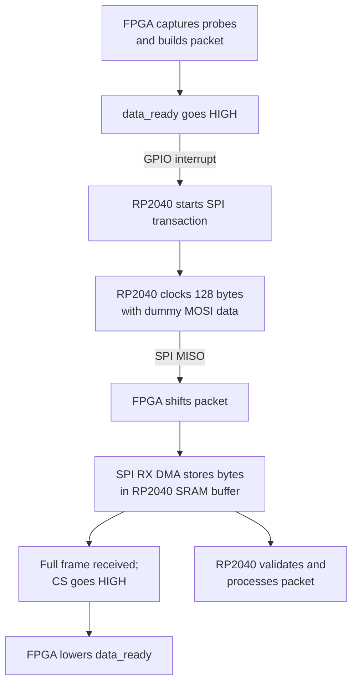

# pld-de10

## Debug capture flow

The FPGA samples the RALU debug probes after a rising edge of `lab_clk` and
holds the resulting packet until the RP2040 reads a complete SPI frame.

### Step by step

1. The FPGA synchronizes `lab_clk` to its 50 MHz clock and detects a rising
   edge. After the settle interval, it snapshots the probes, increments the
   sample number, and builds the packet.
2. `data_ready` goes high to indicate that a packet is available. The FPGA
   holds that packet while it waits for a complete SPI read.
3. Connect `data_ready` to an RP2040 GPIO configured for a rising-edge
   interrupt. The interrupt can start the SPI transfer directly or signal a
   task to start it.
4. The RP2040 is the SPI master. It asserts chip select and clocks 128 bytes
   in SPI mode 0 (CPOL=0, CPHA=0). It sends dummy MOSI data to generate the
   clocks; the FPGA returns the packet on MISO.
5. The RP2040 SPI RX DMA channel can write the received bytes into a
   128-byte buffer in RP2040 SRAM. The RP2040 firmware chooses the buffer
   address; the FPGA does not specify a fixed memory address.
6. After a complete frame and the end of chip select, the FPGA lowers
   `data_ready`. Firmware can then validate and process the received buffer.
   An incomplete read does not consume the pending packet: `data_ready` stays
   high so the RP2040 can retry.

The DMA/interrupt flow above describes how firmware can integrate with this
FPGA interface; this repository contains the FPGA RTL and simulation, not
RP2040 firmware or a board-level wiring configuration. Connect the SPI and
ready signals to suitable GPIOs, with a common ground and compatible I/O
levels.

## SPI packet format

The FPGA always transmits exactly 128 bytes, most-significant bit first within
each byte. Multi-byte fields and signal values are little-endian
(least-significant byte first). The frame contains 14 signal records. Their
count is fixed by this implementation and is not sent as a separate field.

| Byte offset | Length | Field | Description |
| --- | ---: | --- | --- |
| 0 | 1 | Start marker | `0xA5` |
| 1 | 1 | Protocol version | `0x01` |
| 2–3 | 2 | Sample number | Unsigned 16-bit count; byte 2 is low, byte 3 is high |
| 4–45 | 42 | Signal records | 14 records of `{signal_id, width_in_bits, value}` |
| 46–126 | 81 | Reserved padding | `0x00` |
| 127 | 1 | Checksum | XOR of bytes 0–126 |

Each record is packed in ascending signal ID order:

| Record bytes | Field | Description |
| --- | --- | --- |
| First | Signal ID | Index from the debug IP signal map below |
| Second | Width | Number of meaningful bits in the signal value |
| Following | Value | `ceil(width / 8)` bytes, least-significant byte first |

All current signals are at most 4 bits wide, so each value occupies one byte.
Thus every current record is 3 bytes and byte 4 begins record 0: it is the
signal ID, not a separate signal-count field. The records end at byte 45;
bytes 46–126 are zero padding. The checksum in byte 127 is the XOR of every
byte from the start marker through the final padding byte.

### Debug IP signal ID map

The packet's signal ID selects a signal as a whole. The listed probe slice
shows where its value is wired in the 44-bit `probes` bus. Narrow inputs are
zero-extended by `debug_demo` to fill their four-bit probe slices.

| Packet ID | Signal | Width (bits) | Probe bit(s) |
| ---: | --- | ---: | --- |
| 0 | `lab_clk` (debug IP input `clk`) | 1 | 0 |
| 1 | `s_l` | 1 | 1 |
| 2 | `cin` | 1 | 2 |
| 3 | `cout` | 1 | 3 |
| 4 | `input_data` | 4 | 7:4 |
| 5 | `msa` | 2 | 11:8 |
| 6 | `msb` | 2 | 15:12 |
| 7 | `msc` | 3 | 19:16 |
| 8 | `reg_a` | 4 | 23:20 |
| 9 | `reg_b` | 4 | 27:24 |
| 10 | `output_data` | 4 | 31:28 |
| 11 | `a_and_b` | 4 | 35:32 |
| 12 | `a_or_b` | 4 | 39:36 |
| 13 | `a_plus_b` | 4 | 43:40 |

## RTL and simulation

- `debug_ip.sv` maps signals to probe IDs.
- `spi_slave.sv` captures probes and implements the packet and SPI interface.
- `debug_demo.sv` connects the RALU, debug IP, and SPI slave.
- `debug_tb.sv` simulates receiving and checking a complete 128-byte packet.

The testbench can also export verified SPI reads for firmware testing. See
[packet export instructions](demo_sem_one/tb/README.md) for Questa commands,
header generation, and the firmware handoff format.
