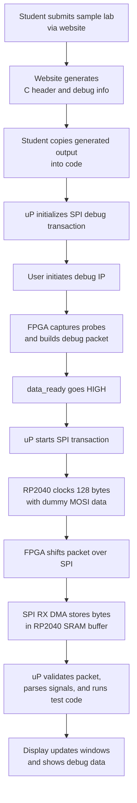

# pld-de10

## Goal architecture

This project is a hardware lab debugging platform where a student submits a sample lab package through a website, receives the generated C header and debug metadata, and then copies that output into their own code to run tests and pull signal data from the FPGA.

The current system is not the final universal lab platform yet; it is the working proof-of-concept that establishes the key flow: website output, embedded execution, FPGA signal capture, and SPI-based debug transfer. The current sample lab used for this flow is DLOG Lab4_RALU, which serves as the reference design for generating the debug header and validating the signal packet.

| System | What it does |
| --- | --- |
| FPGA debug IP | Captures named internal signals, builds the debug packet, and exposes the packet to the SPI slave interface |
| MCU firmware (RP2040) | Initializes the debug transaction, receives the packet over SPI, validates it, and drives the screen/UI |
| Website | Accepts a student lab submission, generates the C header and debug metadata, and gives the student the files needed for integration |
| FPGA-to-uP pipeline | Transfers captured signal data from the DE10 to the RP2040 over SPI so the uP can inspect and process it |

The system is designed around a simple user workflow: a student uploads a sample lab or test bundle to the website, the website produces the generated debug information and C header, the student copies that output into their code, and then the firmware runs tests that read the debug signals and process the returned FPGA data.

## Current architecture

This is the architecture of the system that is currently working and is the immediate implementation of the project.

The current debug flow starts with the website producing the lab-specific header and debug information for DLOG Lab4_RALU. Once that output has been copied into the student’s code, the uP is responsible for starting the SPI transaction with the FPGA. The FPGA holds the debug packet until the uP requests it, and the `data_ready` flag is used to signal that a new packet is ready to be transferred.

In this architecture, the `data_ready` signal is the trigger for the whole SPI exchange. When the FPGA has captured the current signal state and assembled a valid packet, it asserts `data_ready`. The RP2040 detects that signal, initializes the SPI transaction, clocks the required bytes, and reads the packet back from the FPGA. The FPGA acts as the SPI slave, shifts the packet out on MISO, and the uP receives it, validates the checksum and frame format, and then uses the data for the test and debug logic.

This is the current working model: website generates the lab-specific debug artifacts, the uP initializes the SPI transaction, the FPGA provides the packet over SPI, and the embedded software processes the captured signals and displays them on the device screen.

| File | Role |
| --- | --- |
| `debug_ip.sv` | Maps internal signals to debug IDs and exposes them to the SPI packet builder |
| `spi_slave.sv` | Captures signal states, assembles the packet, and performs the SPI slave transfer |
| `debug_demo.sv` | Connects the logic under test, debug IP, and SPI slave into a working instance |
| `debug_tb.sv` | Verifies the packet format and checks the full SPI transaction flow |

Packet: 128 bytes, SPI mode 0.

| Byte | Field |
| --- | --- |
| 0 | Start marker `0xA5` |
| 1 | Protocol version `0x01` |
| 2–3 | Sample number (little-endian) |
| 4–45 | 14 signal records, `{id, width, value}` |
| 46–126 | Padding `0x00` |
| 127 | Checksum, XOR of bytes 0–126 |

## What works

The current project already verifies the core debugging path that the larger platform depends on.

| Item | Status |
| --- | --- |
| Debug IP signal map for internal observation | Working |
| SPI slave and packet assembly on the FPGA side | Working |
| Packet format for debug transfer | Working |
| Testbench validation of a full debug packet | Working |
| SPI packet framing and byte serialization flow | Working |
| uP-side packet reception and parsing structure | Working |
| `data_ready` signal handoff to the SPI transaction | Working |
| Screen, menu, and button interface for the device UI | Working |
| Website generation of a sample lab’s debug output and C header | Working conceptually |
| Student code integration for copied debug header and data | In development |
| Full test execution from generated outputs | Planned |
| Multi-window debug UI on the embedded display | Planned |

The key current capability is that the FPGA can produce a debug packet only when the system is ready, and the RP2040 can coordinate the SPI transaction to pull that packet into memory. Once the uP receives the packet, it can check the format, parse the signal data, and use that information to update the screen or run user-defined test logic. This is the actual foundation upon which the full website-to-hardware lab workflow is built.

## What does not work yet

The working pieces are the low-level hardware signals and packet transfer path, but the end-to-end lab workflow still needs to be connected together more completely.

| Item | Status |
| --- | --- |
| Student upload workflow for sample lab submissions | In progress |
| Automatic generation of C header and debug output from uploaded files | In progress |
| Copy-and-paste integration of generated code into a testbench or firmware project | In progress |
| Full execution of student test code against FPGA debug data | Planned |
| Result processing and pass/fail evaluation pipeline | Planned |
| Multi-view debugger interface with live signal inspection | Planned |
| Logic driver flow from uP to DE10 for controlled signal injection | Planned |
| End-to-end universal lab submission to debug workflow | Planned |

## Future plan

The future goal is to expand this project from a working debug-transfer pipeline into a general-purpose lab submission platform. In that version, a student uploads a zip file to the website, the website generates the appropriate C header and debug metadata, and the student copies that generated output into their code. The RP2040 then runs the test logic, reads the FPGA signal data, validates the result, and displays the relevant debug information on the screen.

This is the broader long-term vision, but it is separate from the current working architecture. Today, the system is focused on the proven mechanism: `data_ready` triggers the FPGA debug packet, the uP initializes the SPI transaction, the FPGA shifts the packet, and the uP processes the result. The future work is to automate and generalize that workflow so it can support many labs and many student submissions.

## Team responsibilities

| Person | Current role and contributions |
| --- | --- |
| Omar | Works on the uP communication path, SPI packet handling, and the low-level data-transfer framework between the FPGA and the embedded software. |
| Daphne | Leads the embedded display and UI work, including menu flow, screen updates, and user interaction on the RP2040. |
| Soor | Focuses on the FPGA debug IP, SPI slave implementation, packet structure, and the website-based lab submission workflow. |
| Lucas | Supports the website and testbench side, including refinement of the lab submission tooling and validation of packet/test flow. |

## Current bugs to fix

These are the small issues we still need to clean up in parts of the system that already work.

| Bug | Where | Description |
| --- | --- | --- |
| `data_ready` timing | FPGA/uP handoff | The packet is mostly correct, but the exact timing between the FPGA asserting `data_ready` and the uP beginning the SPI transaction needs to be made more consistent. |
| Stale packet handling | Debug pipeline | If a previous packet is still present or the system is not fully reset between reads, the uP can process old data instead of the newest debug state. |
| Transfer boundary checks | SPI receive path | The RP2040 should be more strict about detecting incomplete or misaligned SPI reads at the end of a transfer. |
| Display refresh timing | Embedded UI | The screen may briefly lag behind the latest packet data when the UI updates or switches views. |

These are minor compared with the larger missing features, but they are the kinds of bugs that make the working system feel unreliable if left unresolved.