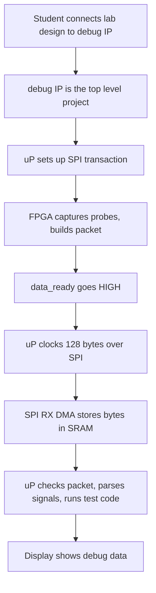

# pld-de10

## Goal architecture

For each lab, we will have a ready-made debug IP that the student connects to their design and makes the top level of the project. The student does not need to change the firmware; the uP software still handles the SPI transaction, packet validation, and display updates, while the debug IP is the part that changes for each lab.

The sample lab right now is DLOG Lab4_RALU. We use it as the reference design to generate the debug packet and check the signal flow.

| System | What it does |
| --- | --- |
| FPGA debug IP | Captures named internal signals and builds the debug packet for the SPI slave |
| MCU firmware (RP2040) | Starts the SPI transfer, receives and checks the packet, runs the screen/UI |
| Website | Takes a lab submission and generates the custom debug IP and C header for that lab |
| FPGA to uP pipeline | Sends the captured signals from the DE10 to the RP2040 over SPI |

The current workflow is: the lab already has a debug IP, the student connects their design to that IP and makes it the top level, then the uP starts the SPI transaction, checks the packet, and updates the display. The FPGA raises `data_ready`, the RP2040 starts the SPI transaction, and the packet is read back over MISO.

The long-term goal is for a user to upload a Quartus project as a zip file to our website, and the website would generate a custom debug IP and custom C header that maps signal IDs to signal names. There may also be an automated way to load the PLD with that custom configuration, but that still needs to be designed.

## Current architecture

This is what works right now.

The FPGA holds the packet until the uP reads it. When the packet is ready, the FPGA sets `data_ready`. The RP2040 sees it, starts the SPI transfer, and reads the 128 bytes. The FPGA is the SPI slave and sends the packet on MISO. The uP checks the checksum and frame format, then uses the data.

| File | Role |
| --- | --- |
| `debug_ip.sv` | Maps internal signals to debug IDs |
| `spi_slave.sv` | Captures signals, builds the packet, does the SPI transfer |
| `debug_demo.sv` | Connects the lab design, debug IP, and SPI slave |
| `debug_tb.sv` | Testbench that checks the packet and a full SPI read |

Packet: 128 bytes, SPI mode 0.

| Byte | Field |
| --- | --- |
| 0 | Start marker `0xA5` |
| 1 | Protocol version `0x01` |
| 2–3 | Sample number (little-endian) |
| 4–45 | 14 signal records, `{id, width, value}` |
| 46–126 | Padding `0x00` |
| 127 | Checksum, XOR of bytes 0–126 |

## What works

| Item | Status |
| --- | --- |
| Debug IP signal map | Working |
| SPI slave and packet building on the FPGA | Working |
| Packet format | Working |
| Testbench check of a full packet | Working |
| SPI packet framing and byte conversion | Working |
| uP packet receiving and parsing | Working |
| `data_ready` handoff to the SPI transfer | Working |
| Screen, menu, and buttons | Working |
| Website generating the header and debug output for the sample lab | Working, still rough |
| debug IP generation for a specific lab | Planned |

## What does not work yet

| Item | Status |
| --- | --- |
| Student upload of sample labs | In progress |
| Generating the C header and debug output from uploaded files | In progress |
| Putting the generated code into a testbench or firmware project | In progress |
| Running student test code against FPGA data | Planned |
| Pass/fail results | Planned |
| Multi-window debug UI on the display | Planned |
| Logic driver (uP to DE10, changing signals) | Planned |
| Upload any lab and get a working debug setup | Planned |

## What we hope to improve

Right now this only works for one sample lab. We want it to work for many labs. A student would upload a Quartus project as a zip, the website would generate a custom debug IP and matching C header for that specific lab, and the student would connect that debug IP into their design as the top level. The RP2040 would still do the same SPI transaction and signal processing, and then the results would be shown on the screen.

## Bugs

| Bug | Where | Description |
| --- | --- | --- |
| `data_ready` timing | FPGA/uP handoff | Time between the FPGA setting `data_ready` and the uP starting the SPI transfer isn't consistent |
| Stale packets | Debug pipeline | If the system isn't fully reset between reads, the uP can process an old packet |
| Transfer boundary checks | SPI receive | The RP2040 doesn't reliably catch incomplete or misaligned reads |
| Display refresh | UI | The screen can lag behind the latest packet when the view changes |

## Who worked on what

| Person | Worked on |
| --- | --- |
| Omar | uP communication, SPI packet handling, FPGA to uP data transfer |
| Daphne | Screen and UI, menu flow, button input |
| Soor | Debug IP, SPI slave, packet format, website |
| Lucas | Website, testbench work |